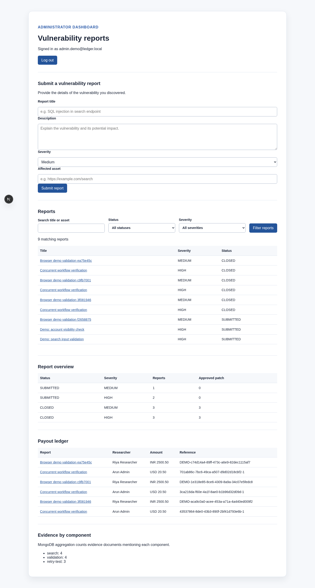

# Automated Bug Bounty Vulnerability Patch & Payout Ledger

A two-person DBMS project using Next.js, PostgreSQL/Prisma, and MongoDB. Researchers
submit vulnerability reports and sanitized evidence. Administrators review reports,
review remediation patches, close findings, and record one bounty payment per report.
The ledger records externally completed payments; it does not transfer money.

[Setup](#setup) · [Lifecycle](#lifecycle-and-integrity) · [API reference](#application-and-apis) · [Verification](#verification-and-demo) · [Demo guide](docs/demo-guide.md) · [Viva guide](docs/viva-guide.md) · [Project report](docs/project-report.md)

## Features

| Capability | Researcher | Administrator |
|---|---|---|
| Vulnerability reports | Submit and view own reports | View all reports and manage lifecycle |
| Sanitized evidence | Add and view evidence for own reports | Add and view evidence for all reports |
| Patch management | View remediation and review results | Submit, approve, or reject patches |
| Bounty ledger | View payouts for own reports | Record eligible payouts and view all payments |
| Reporting and audit | View own report status history | View dashboard summaries, component aggregation, and audit trails |

## Technology and architecture

| Layer | Technology | Responsibility |
|---|---|---|
| Web application | Next.js App Router, React, TypeScript | Researcher and administrator dashboards |
| Backend | Next.js Route Handlers, Zod | Authentication, authorization, request validation |
| Relational database | PostgreSQL, Prisma | Ownership, lifecycle, patches, payouts, history, audit |
| Document database | MongoDB | Flexible reproduction evidence and component aggregation |
| Verification | Vitest, Playwright | Unit, API, database integration, and browser tests |

See the [system architecture](docs/architecture.md) and
[database design](docs/database-design.md) for database boundaries and transaction behavior.

## Application preview

<details>
<summary>View the administrator dashboard</summary>



</details>

[Browse all screenshots](docs/screenshots/README.md), including the researcher dashboard
and a completed report with reviewed patches, payout, history, and audit records.

## Setup

Use Node.js 24, npm 11+, PostgreSQL with its `pgcrypto` extension available, and MongoDB.

```bash
npm ci
cp .env.example .env
```

Configure `.env` for your databases. Set a private `SESSION_SECRET` of at least 32
characters and `SEED_DEMO_PASSWORD` of at least 12 characters. The environment file
is ignored by Git. `DATABASE_URL`, `MONGODB_URI`, and `MONGODB_DB_NAME` configure
application storage; `.env.example` documents every variable.

| Variable | Purpose |
|---|---|
| `DATABASE_URL` | Application PostgreSQL connection |
| `MONGODB_URI`, `MONGODB_DB_NAME` | Evidence database connection and name |
| `SESSION_SECRET` | JWT session signing secret |
| `SEED_DEMO_PASSWORD` | Private password used when seeding demo accounts |
| `TEST_DATABASE_URL`, `TEST_MONGODB_URI` | Optional dedicated integration-test services |

Create the PostgreSQL database named in `DATABASE_URL`, then run:

```bash
npm run db:generate
npx prisma migrate deploy
npm run demo:seed
npm run dev
```

`demo:seed` creates/updates these accounts with your environment-provided password:

| Account | Role |
|---|---|
| `researcher.demo@ledger.local` | Researcher |
| `researcher.second@ledger.local` | Researcher |
| `admin.demo@ledger.local` | Admin |

It also creates two initial reports without resetting existing workflow progress.
`npm run db:seed` seeds only the original researcher/admin accounts. MongoDB's evidence
collection, document validator, and indexes initialize on first use. The MongoDB
account needs collection creation, `collMod`, index, read, and write permissions.

## Lifecycle and integrity

| Current status | Next status |
|---|---|
| SUBMITTED | UNDER_REVIEW or REJECTED |
| UNDER_REVIEW | ACCEPTED or REJECTED |
| ACCEPTED | REMEDIATING |
| REMEDIATING | PATCHED through patch approval |
| PATCHED | CLOSED |
| REJECTED / CLOSED | Terminal |

Admins submit patches during remediation. Each patch records summary, reference,
patch date, submitting admin, creation time, and a pending review. An admin may
approve or reject it; rejection requires a note and permits a replacement patch.
Approval records reviewer/time and advances the report to PATCHED in one transaction.
Reviewed patches are retained. A CLOSED report with an approved patch is eligible
for one payout in INR or USD. The recipient is always the report's researcher.

PostgreSQL owns users, roles, reports, ownership, patches, payouts, history, and audit.
Constraints/triggers enforce lifecycle and eligibility for direct SQL writes too.
Status changes use a conditional update; patch/review/payout transactions lock the
report to serialize concurrent admin actions. Payout amounts are exact decimals;
API inputs allow at most two decimal places and ten integer digits.

The forward migration preserves old records. Legacy patches become PENDING with
nullable historical attribution; completed legacy reports without an approved patch
are not newly payout-eligible. Old payouts remain historical records. New audit
events are recorded prospectively; historical events are not fabricated.

## Application and APIs

The dashboard supports report submission, search/filtering, report details, status
history, evidence, and payout history. Admins additionally see lifecycle controls,
patch review, payout recording, audits, SQL dashboard summaries, and MongoDB component
aggregation. Researchers can access only their own report data. API checks enforce
permissions independently of visible controls.

| Route | Access / behavior |
|---|---|
| `POST /api/auth/login`, `POST /api/auth/logout` | Session creation/clearing |
| `GET /api/reports?q=&status=&severity=` | Scoped report list |
| `POST /api/reports` | Create report; reporter comes from session |
| `GET /api/reports/{reportId}` | Owner/admin detail, history, patches, payout |
| `PATCH /api/reports/{reportId}/status` | Admin lifecycle update |
| `GET/POST /api/reports/{reportId}/evidence` | Owner/admin evidence |
| `POST /api/reports/{reportId}/patches` | Admin patch submission |
| `PATCH /api/reports/{reportId}/patches/{patchId}/review` | Admin final review |
| `POST /api/reports/{reportId}/payouts` | Admin eligible payment record |
| `GET /api/payouts` | Scoped payout history |
| `GET /api/reports/{reportId}/audit` | Admin audit trail |
| `GET /api/reporting/components` | Admin MongoDB aggregation |

Responses use `{data: ...}` or `{error: {code, message}}`. See
[API contracts](docs/api-contract.md) for requests, validation, and retry behavior.
Amounts cross the API boundary as decimal strings. Standard errors use 400, 401,
403, 404, 409, 500, and retryable evidence-storage 503 responses.

## Audit and evidence reliability

Database triggers record report submission/status change, patch submission/review,
and payout recording in the same transaction as the action. Audit rows and payouts
reject updates/deletes. Status history records the actor and initial submission.
Database owners can bypass triggers; this is not tamper-proof storage.

MongoDB holds flexible reproduction steps, components, technical metadata, and
sanitized observations linked to SQL report UUIDs. It never authorizes access.
Evidence POST accepts a UUID `Idempotency-Key`; reuse it for retries of the same
payload. SQL logs an intent before the MongoDB upsert and then a completion or
failure event. A completion-audit failure returns saved evidence with
`auditPending: true`; replaying reconciles it. No distributed transaction is claimed.
An evidence outage leaves report, patch, and payout functions available.

## Verification and demo

**Last verified: 2026-10-25.** All **59 tests across 7 files** and **2 browser scenarios**
passed with PostgreSQL and MongoDB enabled. Lint, production build, Prisma validation,
and fresh/legacy migration checks also passed. Detailed evidence and limitations are
recorded in [testing results](docs/testing.md).

```bash
npm test
npm run lint
npm run build
npx prisma validate
npx playwright install chromium
npm run test:e2e
```

Integration tests run only when `TEST_DATABASE_URL` / `TEST_MONGODB_URI` are configured.
Use dedicated databases, apply migrations to the SQL test database, and keep the
application databases available for the browser tests. Missing integration settings
produce explicit skipped suites. Browser tests require `demo:seed` and create demo
records; run them against disposable/local databases. They start the development
server on port 3000 and save real screenshots.

See [testing evidence](docs/testing.md), [demo steps](docs/demo-guide.md),
[requirements traceability](docs/requirements.md), and [screenshots](docs/screenshots/README.md).

## Production build

With the application databases running and `.env` configured:

```bash
npm run build
npm start
```

## Database documentation

- [Project Report (Soft copy)](docs/project-report.md) and [Viva & Demonstration Guide](docs/viva-guide.md)
- [Architecture](docs/architecture.md), [database design](docs/database-design.md),
  [ER diagram](docs/diagrams/er-diagram.md), and [data dictionary](docs/data-dictionary.md)
- [Important SQL queries](database/queries/important-queries.sql): full-text search,
  JOIN, GROUP BY, HAVING, subqueries, dashboard, ledger, and audit retrieval
- [Safe DDL/DML demonstration](database/queries/ddl-demonstration.sql): CREATE, ALTER,
  DROP, INSERT, UPDATE, DELETE, SELECT using a temporary table
- [Contributions](docs/team-contributions.md) and [implementation evidence](docs/implementation-plan.md)

## Contributors

Samarth implemented the relational foundation, authentication, report APIs, lifecycle,
and initial UI/tests. Rahul completed patch review, payouts, MongoDB evidence,
audit coverage, reporting, and final integration in five commits.

See [team contributions](docs/team-contributions.md) and the
[completion record](docs/implementation-plan.md) for responsibilities and commit history.

## Repository notes

Commit Prisma schema and forward migrations together. Configure Git identity locally
and retain the `github-second` remote for this checkout. Credentials and demo database
rows do not transfer through Git.
