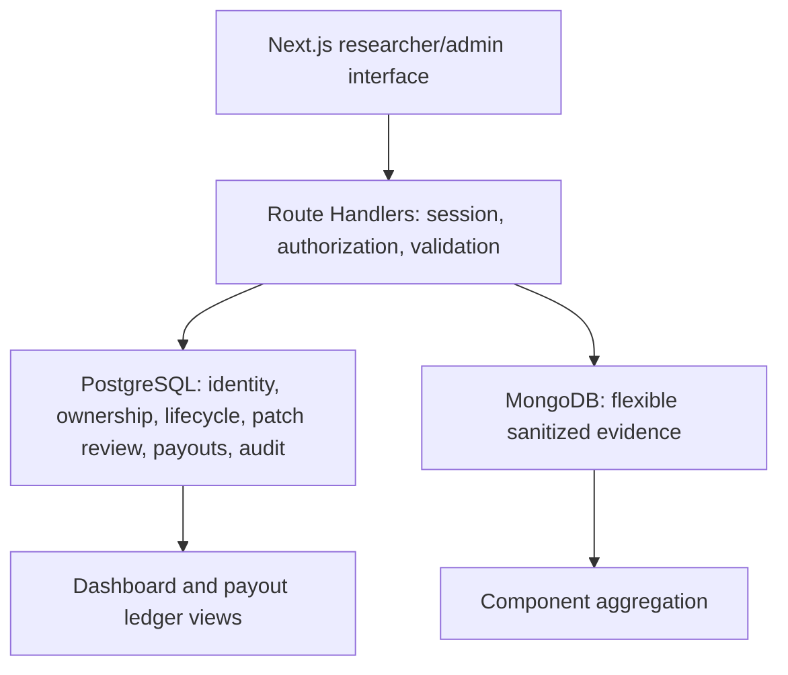

# System architecture

The Next.js interface lets a researcher submit sanitized findings and evidence while
an admin reviews findings, validates remediation, and records a bounty payment.

PostgreSQL is authoritative for permissions and report existence. MongoDB contains
only evidence referenced by report UUID. Every evidence request verifies SQL access
before touching MongoDB. Aggregation is admin-only and filters SQL-owned report IDs.

Report submission creates history and audit through SQL triggers. Status updates
compare the previous status atomically. Patch/review/payout APIs lock the report in a
transaction; approval and PATCHED status are committed together. SQL triggers also
check lifecycle, approval, and payout eligibility for direct writes. Trigger-generated
audit records roll back with the operation, so there are no duplicate application
logs for those actions. API errors omit database internals and secrets.

Evidence uses a SQL audit intent, a MongoDB upsert keyed by a stable UUID, and a SQL
completion/failure event. Replays verify actor/report/payload hash. Failure before
MongoDB insertion returns a retryable 503; failure to append completion after a saved
document returns `auditPending`. Replaying reconciles completion. This is an explicit
cross-database recovery protocol, not a distributed transaction. No automatic
background reconciler is included; clients retain retry keys until completion.

| Action | Researcher | Admin |
|---|---|---|
| Create report | Own | Own |
| Read report/evidence/patch/history/payout | Own reports | All |
| Submit evidence | Own reports | All |
| Change status, submit/review patch, record payout | Denied | Allowed by lifecycle |
| Read audit/component aggregation | Denied | All |

UI visibility is convenience; Route Handlers and server-rendered detail pages enforce
scope independently. Payments are ledger entries for externally completed transfers.
