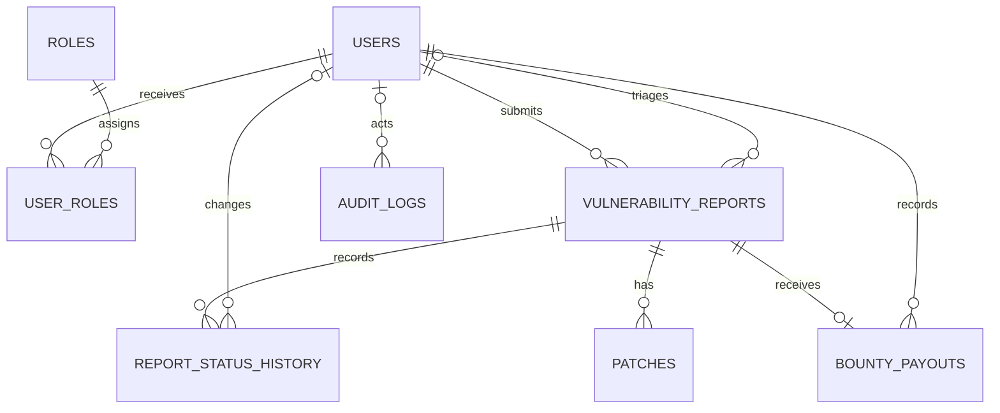
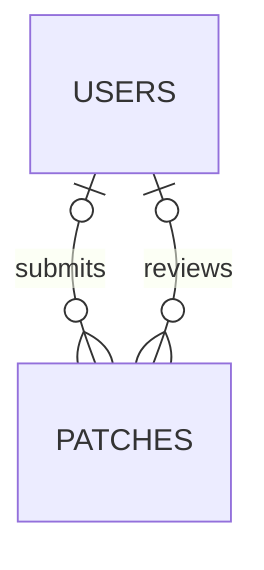

# ER diagram

MongoDB's `report_evidence` collection is intentionally not shown as a relational entity. It references the PostgreSQL report UUID but has no cross-database foreign key.

Patch actor relationships added by the completion migration:

Both actor keys reference `users.id`. Submission attribution is nullable only for
legacy patches; reviewed patches require a reviewer and review timestamp.
