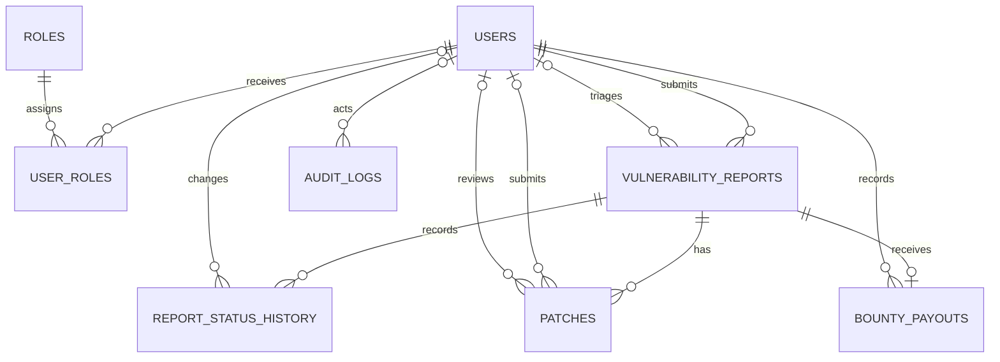
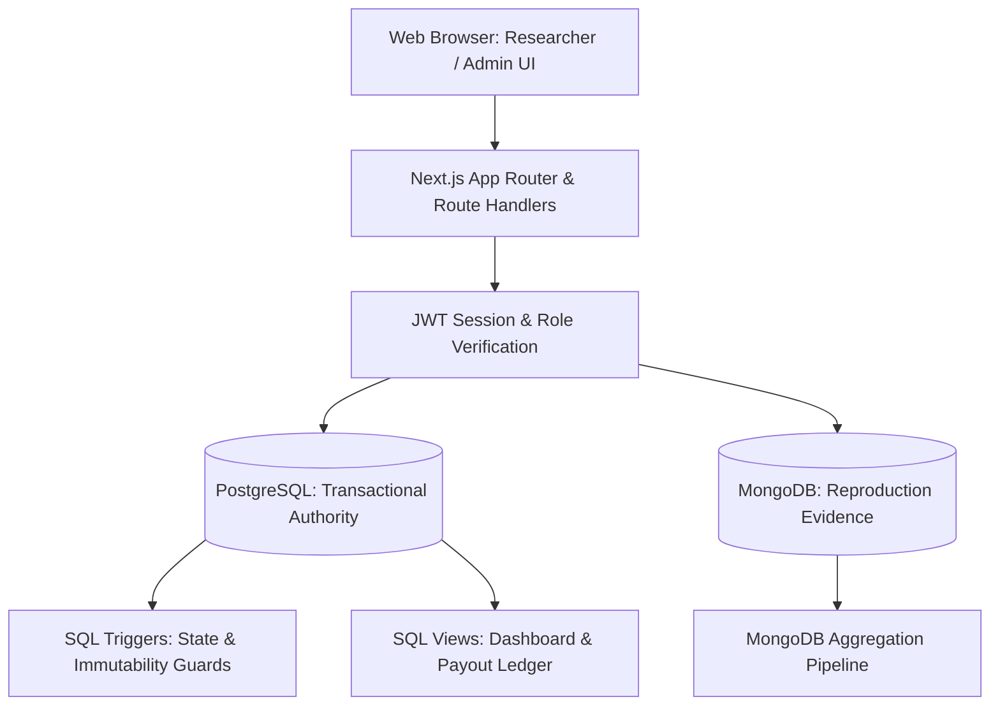

# DBMS Experiential Learning — Level 3 Project Report
# Automated Bug Bounty Vulnerability Patch & Payout Ledger

**Course:** Database Management Systems (Sem-5)  
**Department:** Computer Science and Engineering, PES University  
**Instructor:** Dr. Nagasundari S  

**Team Details:**
- **Member 1:** Samarth Ramesha (`mail.samarth.r@gmail.com`)
- **Member 2:** Rahul B (SRN: `PES2UG24CS393`, `rahulbiju512@gmail.com`)

---

## 1. Objectives
The primary objective of the **Automated Bug Bounty Vulnerability Patch & Payout Ledger** is to engineer an enterprise-grade, multi-paradigm database system that manages the end-to-end lifecycle of security vulnerability reporting, triage, patch verification, audit logging, and financial bounty disbursements.

Key objectives:
1. **Prevent Fraud and Double Payouts:** Enforce strict single-payout constraints and exact decimal accounting for monetary rewards.
2. **Enforce State Integrity:** Implement rigorous database-level state machines preventing premature payouts or status skipping.
3. **Multi-Paradigm Separation of Concerns:** Leverage relational ACID guarantees (PostgreSQL) for transactional authority while using document storage (MongoDB) for semi-structured reproduction evidence and component aggregation.
4. **Immutable Audit Trails:** Maintain tamper-evident, append-only historical audit logs of all privileged actions using database triggers.
5. **Role-Based Access Control:** Strictly isolate researcher observations from global administrative triage and governance.

---

## 2. Functional Requirements
1. **User Authentication & Scoped Authorization:**
   - Multi-role support (`RESEARCHER`, `ADMIN`) using salted password hashes and signed HTTP-only JWT sessions.
   - Researchers can only view, submit, and append evidence to their own vulnerability findings.
   - Administrators possess system-wide privileges to review reports, evaluate patches, execute payouts, and inspect audit logs.
2. **Report Lifecycle State Machine:**
   - Sequential progression: `SUBMITTED -> UNDER_REVIEW -> ACCEPTED -> REMEDIATING -> PATCHED -> CLOSED`.
   - Admin rejection permitted from `SUBMITTED` or `UNDER_REVIEW`.
   - Illegal state transitions blocked at both application and database engine layers.
3. **Patch Review Workflow:**
   - Patches submitted during `REMEDIATING`.
   - Administrators can review patches (`APPROVED` or `REJECTED`).
   - Patch approval atomically transitions the vulnerability report to `PATCHED`.
   - Rejection mandates a descriptive note and permits replacement patches while retaining full audit history.
4. **Bounty Payout Ledger:**
   - Bounty payouts can only be recorded for `CLOSED` reports with an `APPROVED` remediation patch.
   - Payout amounts enforced as positive exact decimals (`NUMERIC(12,2)`); currencies restricted to ISO codes (`INR`, `USD`).
   - Exactly one bounty payout allowed per report (`UNIQUE(report_id)`).
   - Recipient automatically resolved to report owner. Payout ledger is immutable (no UPDATE/DELETE).
5. **Flexible Evidence & Aggregation:**
   - Researchers submit structured reproduction steps, observations, affected components, and arbitrary technical metadata.
   - Component aggregation dynamically ranks the most vulnerable subsystems.

---

## 3. ER Diagram
The relational database design models users, roles, reports, status history, patches, payouts, and audit logs.



*Note on NoSQL entity:* MongoDB's `report_evidence` collection stores reproduction data linked to `reportId` (UUID). There are intentionally no cross-database foreign keys.

---

## 4. Relational Schema
The PostgreSQL schema consists of seven normalized relations:

1. **`users`** (`id` UUID [PK], `email` VARCHAR(255) [UNIQUE], `display_name` VARCHAR(120), `password_hash` VARCHAR(255), `created_at` TIMESTAMPTZ, `updated_at` TIMESTAMPTZ)
2. **`roles`** (`id` UUID [PK], `name` RoleName [UNIQUE: RESEARCHER, ADMIN], `created_at` TIMESTAMPTZ)
3. **`user_roles`** (`user_id` UUID [FK -> users.id], `role_id` UUID [FK -> roles.id], `assigned_at` TIMESTAMPTZ, PRIMARY KEY (`user_id`, `role_id`))
4. **`vulnerability_reports`** (`id` UUID [PK], `title` VARCHAR(200), `description` TEXT, `affected_asset` VARCHAR(255), `severity` Severity, `status` ReportStatus, `reporter_id` UUID [FK -> users.id], `assigned_admin_id` UUID [FK -> users.id], `last_status_changed_by` UUID [FK -> users.id], `created_at` TIMESTAMPTZ, `updated_at` TIMESTAMPTZ)
5. **`report_status_history`** (`id` UUID [PK], `report_id` UUID [FK -> vulnerability_reports.id], `from_status` ReportStatus, `to_status` ReportStatus, `changed_by_id` UUID [FK -> users.id], `note` VARCHAR(500), `changed_at` TIMESTAMPTZ)
6. **`patches`** (`id` UUID [PK], `report_id` UUID [FK -> vulnerability_reports.id], `summary` TEXT, `reference` VARCHAR(255), `review_status` PatchReviewStatus, `submitted_by_id` UUID [FK -> users.id], `reviewed_by_id` UUID [FK -> users.id], `reviewed_at` TIMESTAMPTZ, `review_note` VARCHAR(500), `patched_at` TIMESTAMPTZ, `created_at` TIMESTAMPTZ, UNIQUE (`report_id`, `reference`))
7. **`bounty_payouts`** (`id` UUID [PK], `report_id` UUID [UNIQUE, FK -> vulnerability_reports.id], `amount` NUMERIC(12,2), `currency` CHAR(3), `reference` VARCHAR(100) [UNIQUE], `recorded_by_id` UUID [FK -> users.id], `recorded_at` TIMESTAMPTZ)
8. **`audit_logs`** (`id` UUID [PK], `actor_id` UUID [FK -> users.id], `action` VARCHAR(100), `entity_type` VARCHAR(50), `entity_id` UUID, `metadata` JSONB, `created_at` TIMESTAMPTZ)

---

## 5. Database Choice and Justification

### Paradigm 1: Relational Database (PostgreSQL)
- **Role:** Transactional Authority, Core Workflows, Identity, Financial Ledger, Audit Trail.
- **Justification:**
  - **ACID Transactions:** Payout recording and patch review require serializable execution with row-level locking (`SELECT ... FOR UPDATE`) to prevent race conditions.
  - **Relational Integrity & Foreign Keys:** Cascading deletes where appropriate (`user_roles`, `patches`), restrictive deletes on users/reports for payouts (`ON DELETE RESTRICT`).
  - **Procedural Guards & Triggers:** PL/pgSQL triggers enforce business rules directly inside the engine, guaranteeing that unauthorized direct SQL writes fail.
  - **Mathematical Precision:** `NUMERIC(12,2)` guarantees exact decimal handling for payments without IEEE-754 floating-point inaccuracies.

### Paradigm 2: Document Database (MongoDB)
- **Role:** Flexible Reproduction Evidence & Component Aggregation.
- **Justification:**
  - **Schema Flexibility:** Reproduction steps vary drastically across bug types (web exploits, race conditions, memory leaks). Arbitrary technical metadata (headers, browser versions, runtime flags) are naturally represented as JSON documents.
  - **Array Handling & Multikey Indexes:** Vulnerability findings affect multiple microservices or software components. MongoDB natively indexes and queries array fields (`{ affectedComponents: 1 }`).
  - **Aggregation Pipeline:** Native high-performance analytics pipelines (`$unwind`, `$group`, `$sort`) aggregate component vulnerability frequencies across thousands of evidence records without relational joins.

---

## 6. Data Dictionary / Schema Description

| Table / Collection | Attribute | Type | Constraints / Rules | Description |
|---|---|---|---|---|
| `users` | `id` | UUID | PK, default `gen_random_uuid()` | Unique user identifier |
| `users` | `email` | VARCHAR(255) | UNIQUE, NOT NULL, length > 3 | User login email address |
| `users` | `password_hash`| VARCHAR(255) | NOT NULL | Salted cryptographic password hash |
| `roles` | `name` | ENUM | UNIQUE, NOT NULL (`RESEARCHER`, `ADMIN`) | System access role |
| `user_roles` | `user_id`, `role_id` | UUID, UUID | Composite PK, FKs with `ON DELETE CASCADE` | Role assignment mapping |
| `vulnerability_reports` | `id` | UUID | PK, default `gen_random_uuid()` | Unique report identifier |
| `vulnerability_reports` | `title` | VARCHAR(200) | NOT NULL, CHECK length >= 8 | Brief vulnerability title |
| `vulnerability_reports` | `description`| TEXT | NOT NULL, CHECK length >= 20 | Vulnerability narrative |
| `vulnerability_reports` | `affected_asset`| VARCHAR(255) | NOT NULL, CHECK length > 0 | Target domain, URL, or service |
| `vulnerability_reports` | `severity` | ENUM | LOW, MEDIUM, HIGH, CRITICAL | Risk rating |
| `vulnerability_reports` | `status` | ENUM | ReportStatus enum, DEFAULT `SUBMITTED` | Current lifecycle state |
| `report_status_history`| `report_id` | UUID | FK -> `vulnerability_reports.id` CASCADE | Report reference |
| `report_status_history`| `from_status`, `to_status` | ENUM | CHECK `from_status <> to_status` | Status transition delta |
| `patches` | `reference` | VARCHAR(255) | NOT NULL, UNIQUE with `report_id` | Commit SHA, PR URL, or version |
| `patches` | `review_status`| ENUM | PENDING, APPROVED, REJECTED | Current patch triage decision |
| `patches` | `review_note` | VARCHAR(500) | Mandatory when REJECTED | Rejection rationale |
| `bounty_payouts` | `amount` | NUMERIC(12,2)| NOT NULL, CHECK amount > 0 | Bounty amount |
| `bounty_payouts` | `currency` | CHAR(3) | DEFAULT 'INR', CHECK regex `^[A-Z]{3}$` | ISO currency code |
| `bounty_payouts` | `reference` | VARCHAR(100) | UNIQUE, NOT NULL | External banking or transaction ID |
| `audit_logs` | `action` | VARCHAR(100) | NOT NULL | Logged event type |
| `audit_logs` | `metadata` | JSONB | NOT NULL, DEFAULT `{}` | Structured operational metadata |
| `report_evidence` (Mongo) | `_id` | String | PK (UUID operation idempotency key) | Evidence record ID |
| `report_evidence` (Mongo) | `reportId` | String | NOT NULL, regex UUID format | Link to SQL vulnerability report |
| `report_evidence` (Mongo) | `reproduction` | Object | Required steps (1-30), expected, observed | Execution walkthrough |
| `report_evidence` (Mongo) | `affectedComponents` | Array[String]| minItems: 1, maxItems: 30, uniqueItems | Component tags |

---

## 7. SQL and NoSQL Implementation

### A. Advanced SQL Features Implemented (4 Concepts)
1. **ACID Transactions with Row Locking:**
   - Serialized report locking using `SELECT ... FOR UPDATE` during patch approval and payout processing.
   - Atomic multi-table updates ensuring patch review and report status change commit together or roll back completely.
2. **Stored Procedures / Functions & Triggers:**
   - `validate_report_status_transition`: Trigger-based finite state machine.
   - `guard_patch_write`: Enforces that patches can only be submitted in `REMEDIATING` state.
   - `require_approved_patch`: Prevents advancing to `PATCHED` or `CLOSED` without an approved patch.
   - `guard_payout_write`: Prevents payouts unless report is `CLOSED` with an `APPROVED` patch.
   - `retain_audit_event`: Makes `audit_logs` append-only by aborting any UPDATE or DELETE statement.
3. **Indexing Strategies:**
   - Composite B-Tree indexes: `(reporter_id, status)`, `(status, severity, created_at DESC)`, and `(report_id, changed_at DESC)`.
   - GIN Full-Text Search Index: `CREATE INDEX "reports_search_idx" ON "vulnerability_reports" USING GIN (to_tsvector('english', "title" || ' ' || "description"));`.
4. **Relational Views:**
   - `v_report_dashboard`: Groups reports by status and severity, including conditional aggregation `COUNT(*) FILTER (WHERE EXISTS (...))` for approved patches.
   - `v_payout_ledger`: Multi-table join across `bounty_payouts`, `vulnerability_reports`, recording admin `users`, and receiving researcher `users`.

### B. Advanced NoSQL Features Implemented
1. **MongoDB Aggregation Pipeline:**
   - Aggregates component vulnerability frequencies using `$match`, `$unwind`, `$group`, `$sort`, and `$project`.
2. **Native JSON Schema Validation:**
   - Configured via `$jsonSchema` inside `collMod` with strict BSON typing, array length limits, and `additionalProperties: false`.

---

## 8. Important Queries

### Query 1: Full-Text Search using PostgreSQL GIN Index
```sql
SELECT id, title, severity, status
FROM vulnerability_reports
WHERE to_tsvector('english', title || ' ' || description) @@ plainto_tsquery('english', :'search_term')
ORDER BY created_at DESC;
```

### Query 2: Aggregate Reports with GROUP BY and HAVING
```sql
SELECT severity, COUNT(*) AS total_reports
FROM vulnerability_reports
GROUP BY severity
HAVING COUNT(*) >= 1
ORDER BY total_reports DESC, severity;
```

### Query 3: Multi-Table JOIN with Correlated Subquery (`NOT EXISTS`)
```sql
SELECT r.id, r.title, u.display_name AS researcher, r.status
FROM vulnerability_reports r
JOIN users u ON u.id = r.reporter_id
WHERE r.status = 'CLOSED'
  AND NOT EXISTS (SELECT 1 FROM bounty_payouts p WHERE p.report_id = r.id)
ORDER BY r.created_at DESC;
```

### Query 4: SQL Dashboard Aggregation View Definition
```sql
CREATE OR REPLACE VIEW v_report_dashboard AS
SELECT r.status, r.severity, COUNT(*) AS report_count,
       COUNT(*) FILTER (WHERE EXISTS (SELECT 1 FROM patches p WHERE p.report_id = r.id AND p.review_status = 'APPROVED')) AS patched_report_count
FROM vulnerability_reports r
GROUP BY r.status, r.severity;
```

### Query 5: Payout Ledger Multi-Table Join View Definition
```sql
CREATE OR REPLACE VIEW v_payout_ledger AS
SELECT p.id, p.report_id, r.title AS report_title, p.amount, p.currency, p.reference, p.recorded_at,
       u.display_name AS recorded_by, owner.id AS researcher_id, owner.display_name AS researcher
FROM bounty_payouts p
JOIN vulnerability_reports r ON r.id = p.report_id
JOIN users u ON u.id = p.recorded_by_id
JOIN users owner ON owner.id = r.reporter_id;
```

### Query 6: MongoDB Aggregation Pipeline
```javascript
db.report_evidence.aggregate([
  { $match: { reportId: { $in: reportIds } } },
  { $unwind: "$affectedComponents" },
  { $group: { _id: "$affectedComponents", evidenceCount: { $sum: 1 } } },
  { $sort: { evidenceCount: -1, _id: 1 } },
  { $project: { _id: 0, component: "$_id", evidenceCount: 1 } }
]);
```

---

## 9. System Architecture



---

## 10. Application Screenshots
The application interface was verified and captured during end-to-end browser automation:

1. **Researcher Dashboard (`docs/screenshots/researcher-dashboard.png`):**
   - Displays scoped vulnerability submissions, report creation form, and status badges.
2. **Completed Report & Remediation View (`docs/screenshots/report-after-payout.png`):**
   - Demonstrates rejected patches, replacement approved patches, recorded bounty payout, complete status history, and append-only audit trail.
3. **Administrator Dashboard (`docs/screenshots/admin-dashboard.png`):**
   - Demonstrates system-wide report triage, SQL view summaries, global payout ledger, and MongoDB component aggregation charts.

---

## 11. Testing Results

### Test Suite Execution Summary
- **Total Test Cases:** 59 automated test cases across 7 test files, plus 2 Playwright E2E browser scenarios.
- **Result:** 100% Passed.

| Test File | Count | Focus Area |
|---|---:|---|
| `tests/unit/validation.test.ts` | 10 | Field boundaries, string trimming, enum validation |
| `tests/unit/workflow-validation.test.ts` | 16 | Decimal limits, review notes, dates, evidence schemas |
| `tests/api/reports.test.ts` | 11 | Role scoping, IDOR protection, filter combinations |
| `tests/api/workflows.test.ts` | 14 | Privileged transitions, patch reviews, evidence retries |
| `tests/integration/postgresql-schema.test.ts` | 6 | SQL triggers, transaction rollback, view counts |
| `tests/integration/mongodb-evidence.test.ts` | 1 | Native MongoDB JSON Schema, indexing, aggregation |
| `tests/integration/prisma-timestamps.test.ts` | 1 | UTC timestamp synchronization across DB sessions |
| `tests/e2e/workflow.spec.ts` | 2 | Full user lifecycle and concurrent race conditions |

---

## 12. Conclusion
The **Automated Bug Bounty Vulnerability Patch & Payout Ledger** successfully demonstrates the integration of modern multi-paradigm database systems with an interactive web application. By enforcing critical invariants at the database level through PostgreSQL triggers, check constraints, and unique indexes, the system provides mathematical integrity for financial transactions and audit history. Simultaneously, MongoDB accommodates dynamic, semi-structured reproduction evidence and facilitates real-time vulnerability analytics. The project fully satisfies all Level 3 DBMS requirements.
